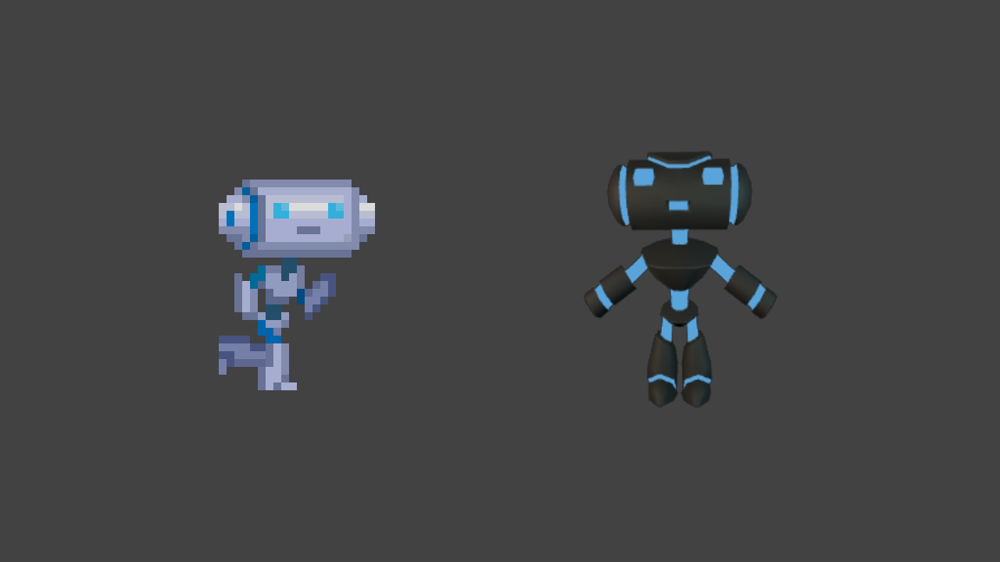
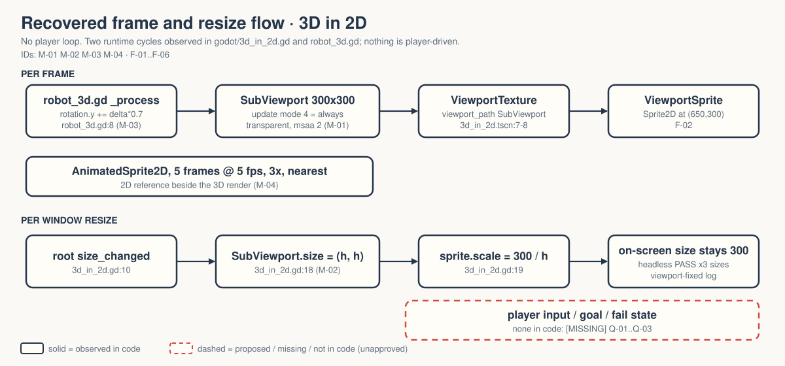

# walker-viewport-3d-in-2d — Game Design Document (recovered)

| | |
|---|---|
| Version | 0.1.0-recovered |
| Date | 2026-09-27 |
| Author | Zelda (agent, `/gdd reverse --path godot silent`), for Nik Bear Brown |
| Mode | recovered, silent |
| Revision | 1 |
| Gates | gate — unsigned at time of writing (vision ○ · systems ○ · world ○ · scope ○) |
| Source | `godot/` — Walker title-only copy of Godot demo `viewport/3d_in_2d`, commit `a3b5c113112f77291d5f3d1360f33a882fdc52f7` `[OBSERVED README.md:3-4]` |
| Engine | Godot 4.7.2 (logs), features "4.7", GL Compatibility `[OBSERVED godot/project.godot:17,31]` |

Provenance tags: `[OBSERVED path:line]` the code or a file in this folder says this · `[INFERRED]` the code strongly implies it; evidence stated · `[MISSING]` nothing here can tell you; logged in `decisions.md`. Paths are relative to the folder root. Dashed elements in diagrams and deck are not in the code.

**What this document is.** A description of what exists, recovered from code. It is not an approved design and it is not a game design: this project is a rendering tech demo. Most design sections below are honestly empty.

*Upstream screenshot shipped with the Godot demo (`godot/screenshots/3d_in_2d.webp`, referenced by `godot/README.md:22`). It is not a Walker capture: no GPU pixels have been inspected in Walker `[OBSERVED FRICTIONAL.md:19-20]`.*

## 1. Vision summary

**What it is.** A single 2D scene that shows a 3D robot, rendered into a `SubViewport`, displayed as an ordinary `Sprite2D` next to a 2D animated sprite. `[OBSERVED godot/project.godot:14; godot/3d_in_2d.tscn:56-72]`

**What it demonstrates.** How to embed 3D in a 2D scene with `ViewportTexture`, and how to keep that embedded render sharp when the window changes size by resizing the render target to the window height and scaling the sprite down to compensate. `[OBSERVED godot/3d_in_2d.gd:13-19; godot/README.md:11-18]`

**Why it exists in Walker.** `[MISSING]` The folder says it is an independent local copy with a title-only change and that two "native-4K Liam films" are pending `[OBSERVED README.md:3-9]`, which implies it is source material for explanatory films `[INFERRED from README.md:8]`. Whether it is also meant as a reusable component for a Walker game is not stated. Q-01.

**Player / audience.** `[MISSING]` No player exists: there is no input action and no goal. The implied audience is a developer learning viewports `[INFERRED from godot/README.md "How does it work?" section]`. Q-02.

**Player fantasy, logline, promise.** Not applicable. A tech demo has no fantasy; inventing one would be lore. `[MISSING]` by design.

## 2. Design pillars

`[MISSING]` No pillars are stated anywhere. The code's structure implies two engineering properties the demo protects, recorded here as inferences, not pillars:

- **Embedded 3D is just a texture.** The robot reaches the screen only through `ViewportTexture` on a `Sprite2D`. `[INFERRED from godot/3d_in_2d.tscn:7-8,64-66]`
- **Resize without quality loss.** The comment says so directly: "handle multiple resolutions without losing quality". `[OBSERVED godot/3d_in_2d.gd:14]`

## 3. Core loop

There is no player loop. There are two runtime cycles:

- **Per frame.** `robot_3d.gd` adds `delta * 0.7` rad to the model's Y rotation `[OBSERVED godot/robot_3d.gd:7-8]`; the `SubViewport` re-renders every frame (`render_target_update_mode = 4`, i.e. always) `[OBSERVED godot/3d_in_2d.tscn:60]`; the sprite shows the texture. The 2D `AnimatedSprite2D` plays five 64×64 atlas frames at 5 fps, looping `[OBSERVED godot/3d_in_2d.tscn:30-51; godot/3d_in_2d.gd:9]`.
- **Per window resize.** Root `size_changed` → `SubViewport.size = (h, h)` → `ViewportSprite.scale = 300 / h` `[OBSERVED godot/3d_in_2d.gd:10,15-19]`. Walker's headless check confirms the arithmetic at 1280×720, 1920×1080 and 800×600 `[OBSERVED viewport-fixed-20260924.log]`.

**Loop honesty test.** Strip the robot and the sprite: nothing is left to decide. That is correct for a demo and fatal for a game. `[INFERRED]`

## 4. Player Experience Goals

`[MISSING]` None. No PX-xx IDs are assigned because there is no player action to serve. If the project is a teaching demo, the honest replacement is a *viewer* goal ("a developer can see that the embedded robot stays sharp at any window size"); that is proposed in Q-02, not approved.

## 5. Mechanics

No player mechanics. Recovered behaviors, as IDs so tests and tickets can reference them:

### M-01 3D-to-texture render `[OBSERVED]`
`SubViewport` 300×300, `transparent_bg = true`, `msaa_3d = 2`, holding `Robot3D` (camera at z 2.75, FOV 65, two tinted omni lights) `[OBSERVED godot/3d_in_2d.tscn:56-62; godot/robot_3d.tscn:9-22]`. Displayed by `ViewportSprite` at (650, 300) `[OBSERVED godot/3d_in_2d.tscn:64-66]`.

### M-02 Height-locked resize compensation `[OBSERVED]`
Render target becomes a square of the window height; sprite scale is `initial_height / window_height`, so on-screen size stays 300 px while render resolution grows `[OBSERVED godot/3d_in_2d.gd:18-19]`. Width is ignored `[OBSERVED same lines]`; behaviour at portrait or very narrow windows is untested `[INFERRED]`.

### M-03 Idle rotation `[OBSERVED]`
0.7 rad/s about Y; no input can change it `[OBSERVED godot/robot_3d.gd:8]`. Tuning value, not approved design.

### M-04 2D reference sprite `[OBSERVED]`
Five-frame `AnimatedSprite2D` at 3× scale with nearest filtering (`texture_filter = 1`) at (350, 300) `[OBSERVED godot/3d_in_2d.tscn:68-72]`. Purpose `[INFERRED]`: a native-2D element for side-by-side comparison with the embedded 3D.

## 6. Systems

### S-01 Scene composition `[OBSERVED]`
`3d_in_2d.tscn` (Node2D root + `3d_in_2d.gd`) → `SubViewport` → instanced `robot_3d.tscn` (Node + `robot_3d.gd`) → `robot.glb` model; `Camera2D` offset (512, 300) `[OBSERVED godot/3d_in_2d.tscn:53-75]`.

### S-02 Display settings `[OBSERVED]`
Stretch mode `canvas_items`, aspect `expand` `[OBSERVED godot/project.godot:26-27]`. Renderer GL Compatibility on desktop and mobile `[OBSERVED godot/project.godot:31-32]`.

No input map, no collision layers, no save/load, no scene transitions: `project.godot` has no `[input]` or `[layer_names]` section and no script calls `change_scene` `[OBSERVED godot/project.godot]`.

## 7. Progression

`[MISSING]` / not applicable. No levels, unlocks, or state that persists.

## 8. World

Not applicable. One screen; a robot and a sprite on the default clear colour. No world rules. `[OBSERVED godot/3d_in_2d.tscn]`

## 9. Narrative

None, and none should be invented. `[MISSING]` by design.

## 10. Characters

The "robot" is a model asset (`robot.glb`) and a matching 2D sprite sheet (`robot_demo.png`) `[OBSERVED godot/robot_3d.tscn:4; godot/3d_in_2d.tscn:4]`. It has no name, behaviour, or role beyond being rotated. Model-specific attribution should be reviewed before redistribution `[OBSERVED FRICTIONAL.md:20-21]`; Q-04.

## 11. Features and priority

| ID | Feature | Status | Priority | Evidence |
|---|---|---|---|---|
| F-01 | 3D robot rendered into SubViewport | implemented, headless-checked | CORE | M-01; `viewport-fixed-20260924.log` "sprite uses viewport texture" |
| F-02 | ViewportTexture on Sprite2D | implemented, headless-checked | CORE | "texture references correct viewport" |
| F-03 | Resize compensation (square target, scaled sprite) | implemented, headless-checked | CORE | M-02; six resize checks |
| F-04 | Idle robot rotation | implemented, headless-checked | SUPPORTING | "3D robot rotates with processing" |
| F-05 | 2D animated reference sprite | implemented, headless-checked | SUPPORTING | "five atlas frames", "2D animation advances" |
| F-06 | Camera2D framing | implemented | SUPPORTING | `godot/3d_in_2d.tscn:74-75` |
| F-07 | Headless diagnostic `test_viewport.gd` (Walker addition) | implemented, 12/12 PASS | TOOLING | `viewport-fixed-20260924.log` |

**CORE: 3 of 7 = 43%**, over the 40% line. For a demo whose entire point is F-01..F-03 this is expected; recorded with both options in `decisions.md` (Q-07), tags left as they are.

"Implemented" means the code exists and headless state checks pass. None of these is visually verified. `[OBSERVED FRICTIONAL.md:19-22]`

## 12. Out of scope

Everything a game would need: input, goals, fail states, audio, UI, save, levels. `[INFERRED from absence in godot/]` Also out of scope for the Walker copy by its own statement: any runtime change beyond the title `[OBSERVED README.md:6]`.

## 13. Technical

- Scenes: `godot/3d_in_2d.tscn` (main), `godot/robot_3d.tscn`. Scripts: `godot/3d_in_2d.gd`, `godot/robot_3d.gd`, `godot/test_viewport.gd` (diagnostic). See `IMPLEMENTATION-MAP.md`.
- Assets: `robot.glb` (1 model), `robot_demo.png` (1 sheet, 5 frames), `icon.webp`; maturity L3 (finished upstream demo art) `[INFERRED]`.
- Verification on record: Godot 4.7.2 headless import and 120-frame runtime exit 0; 12 headless checks pass after one probe fix (the first probe called a nonexistent `get_viewport_path()`) `[OBSERVED FRICTIONAL.md:7-12; viewport-20260924.log; viewport-fixed-20260924.log]`. Root size was set through the engine window property, not an OS resize `[OBSERVED FRICTIONAL.md:16-17]`.
- Not verified: GPU texture pixels, transparency, lighting, MSAA, appearance, 4K capture `[OBSERVED FRICTIONAL.md:19-20]`.

## 14. Risks

| ID | Risk | Likelihood | Impact | Mitigation |
|---|---|---|---|---|
| R-01 | Headless PASS gets read as visual verification | medium | a film or review claims something nobody saw | keep the "headless state only" wording; Q-05 |
| R-02 | Model attribution unreviewed | unknown | redistribution problem | Q-04 before any publication |
| R-03 | Portrait / narrow windows clip the robot (width ignored) | unknown | demo looks broken on phones | test T-04 (proposed) |
| R-04 | Project mistaken for a game and given invented goals | medium | Ghost Center gets filled with fiction | this document; Q-01, Q-03 |

## 15. Open questions

All in `decisions.md`: Q-01 purpose in Walker, Q-02 audience/viewer goal, Q-03 demo or future game, Q-04 model attribution, Q-05 visual acceptance criteria, Q-06 film definition of done, Q-07 CORE overage, Q-08 intended behaviour at narrow windows.

## 16. Tests

Existing `[OBSERVED godot/test_viewport.gd]`, all PASS in `viewport-fixed-20260924.log`:

| ID | Check |
|---|---|
| T-01 | 2D animation started; five atlas frames; animation advances |
| T-02 | 3D robot rotates with processing |
| T-03 | sprite uses a ViewportTexture pointing at `SubViewport` |
| T-04 | square render target + compensated sprite size at 1280×720, 1920×1080, 800×600 |

Proposed (not written, not approved):

| ID | Check |
|---|---|
| T-05 | portrait window (e.g. 600×1000): robot fully visible (R-03) |
| T-06 | GPU capture: transparent background composites over the clear colour, no halo (needs visible capture) |
| H-01 | a person resizes the window by hand and reports whether the robot stays sharp |

## Zelda's notes (silent mode; what I would have said out loud)

Seven-failure-mode read:

1. **Ghost Center — PRESENT, expected.** There is no vision because there is no game. Evidence: §1 "Why it exists in Walker" is `[MISSING]`.
2. **Mechanic Mirage — ABSENT by vacancy.** No PX goals exist to be mirages.
3. **Implementation Void — PARTIAL.** Resize is documented only for landscape sizes; width-limited windows are nobody's documented case (M-02).
4. **Priority Inflation — PRESENT, harmless.** CORE 43%. A three-feature demo cannot be cut further without deleting the demo. Q-07.
5. **Novelist's Trap — ABSENT.** Keep it that way: do not give the robot a name and a backstory to make this look like a game.
6. **Completeness Fallacy — PRESENT.** The pending films and the attribution review are real open questions that previously lived only in README/FRICTIONAL prose; now Q-04..Q-06.
7. **Stagnant Artifact — ABSENT.** CHANGELOG and revision 1 start here.

**First fix:** answer Q-01. Until someone says what this demo is *for* in Walker, every other question is guesswork.
